# System Design AI (sysdesign-ai)

> **Production-Ready AI-Powered System Design Interview Preparation & Simulation Platform**

[](https://github.com/VirendraArekar/sysdesign-ai)
[](LICENSE)
[](https://openjdk.org/)
[](https://spring.io/projects/spring-boot)
[](https://react.dev/)
[](https://tailwindcss.com/)
[](https://ai.google.dev/)

---

## 🚀 Overview

**System Design AI** is an end-to-end, enterprise-grade platform designed to guide engineers from novice to Staff/Principal level across High-Level Design (HLD) and Low-Level Design (LLD).

### Key Features

- **105 Comprehensive System Design Topics**: Complete HLD (scaling points, interactive Mermaid topology, request flow) and LLD (OOP/SOLID principles, UML Class & Sequence diagrams, and multi-language code in Java 25, Python 3, C++ 20, and Go) spanning 8 core domains.
- **13 Complete Curriculum Modules**: Covering fundamentals, networking, database architecture, caching, load balancing, distributed systems, messaging, microservices, security, cloud infra, observability, design patterns, and capacity estimation.
- **Interactive Architecture Designer**: Drag-and-drop canvas powered by React Flow with compact node footprints, custom component palette, and real-time AI architectural reviews (SPOF detection, bottleneck analysis, security audit).
- **HLD Practice Hub (40+ Systems)**: Full architectures for URL Shortener, WhatsApp, Netflix, Uber, Amazon, Distributed Caches, Search Engines, Distributed Job Schedulers, and more.
- **LLD Practice Hub (20 Systems)**: Complete OOP/SOLID solutions, class diagrams, UML, Java implementations, and test suites (Parking Lot, Elevator, BookMyShow, Rate Limiter, etc.).
- **AI Interview Simulator**: Real-time mock interviews with an adaptive AI Principal Architect persona (HLD, LLD, and Distributed Systems tracks) over WebSockets.
- **15-Category Answer Evaluation Engine**: Comprehensive scoring out of 100 with actionable feedback, strengths, weaknesses, and ideal answers.
- **18 Interactive Simulators & Calculators**: QPS, Storage, Bandwidth, Availability, Cache Sizing, Consistent Hashing, CAP Theorem, Rate Limiting, Kafka Partitions, and more.
- **Learning Dashboard & Analytics**: Interview readiness score, daily streaks, topic mastery radar charts, and personalized study roadmaps.
- **RAG & Vector Search**: Semantic search over system design concepts powered by PostgreSQL `pgvector`.
- **Full Responsive Light & Dark Mode**: Seamless theme switching and clean single-line navigation menu across all screens.
- **Admin & Monetization**: Tiered subscription plans (Free/Pro), AI token usage tracking, and role-based access control.

---

## 📸 Platform Tour & Screenshots

### 1. System Design Topics Hub (105 Topics with HLD & LLD)
Browse 105 comprehensive FAANG-level system design topics across 8 categories with live search, dynamic category filtering, and multi-perspective views.

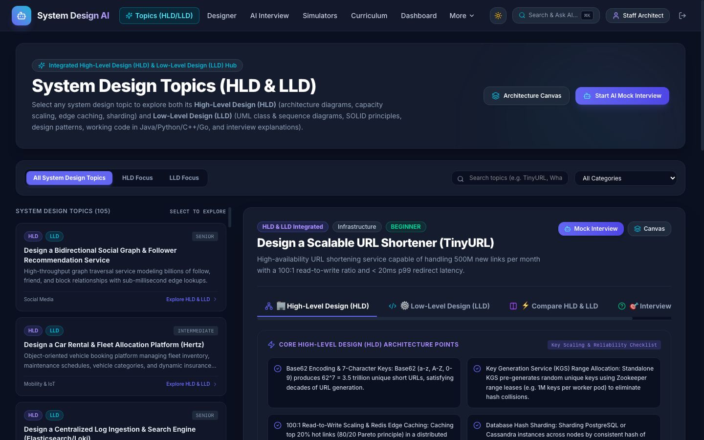

#### High-Level Design (HLD) Perspective
Every topic includes 5 concrete scaling points, interactive Mermaid topology diagrams (`flowchart TD`), request flows, and architectural trade-offs.


#### Low-Level Design (LLD) & UML Perspective
Explore OOP/SOLID patterns, interactive Mermaid Class & Sequence diagrams, and production-ready code in Java 25, Python 3, C++ 20, and Go.

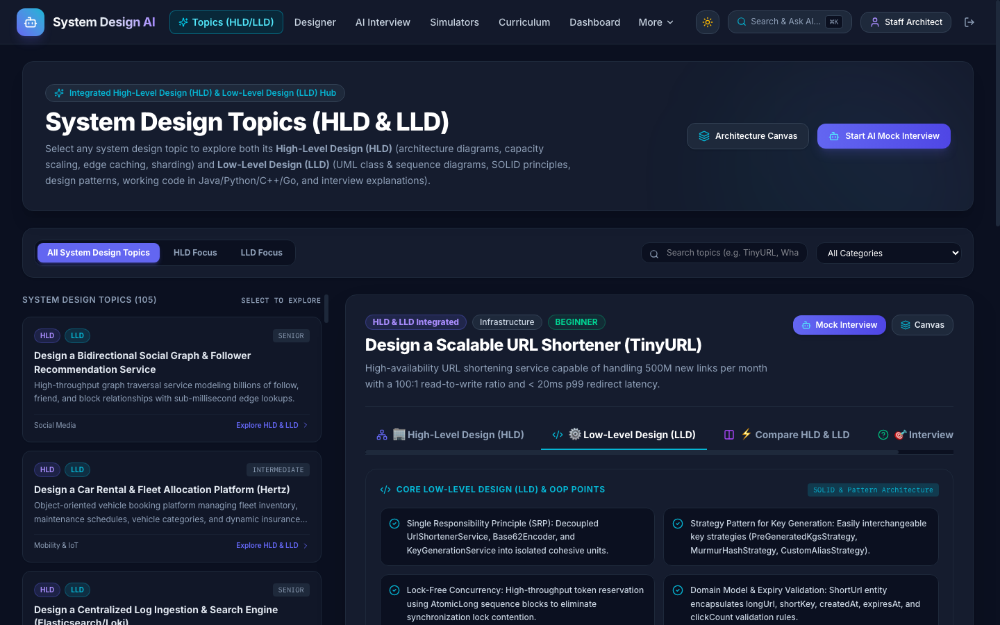

#### Side-by-Side HLD vs LLD Comparison
Directly compare high-level distributed systems concepts with low-level class models and thread-safety concurrency primitives side by side.

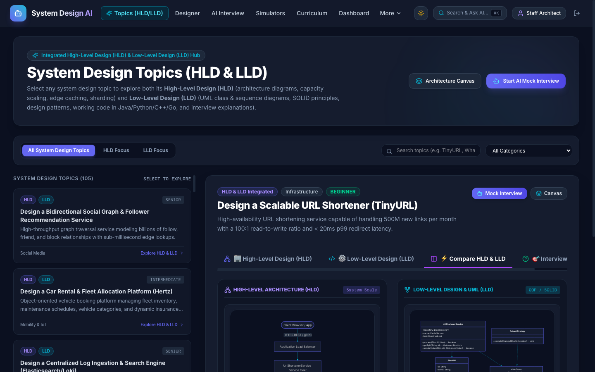

---

### 2. Interactive Architecture Designer (React Flow & AI Audit)
Drag-and-drop system design canvas with custom component palette, zoom/pan controls, connection routing, compact node layouts, and real-time AI architectural audits.

#### Dark Mode
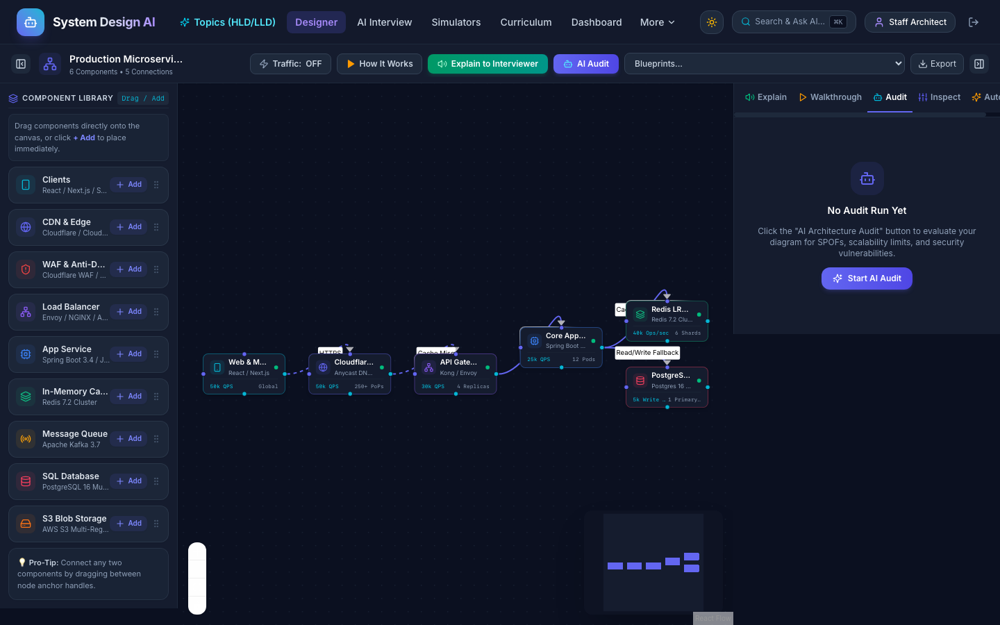

#### Light Mode
Full light and dark theme support across the entire designer canvas and component inspector.

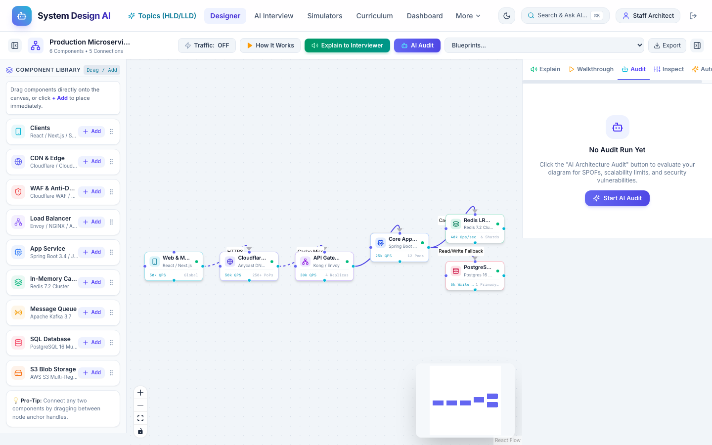

---

### 3. AI Interview Simulator
Real-time adaptive technical interview rounds powered by Google Gemini, simulating FAANG Principal Architect follow-ups and scoring across 15 dimensions.

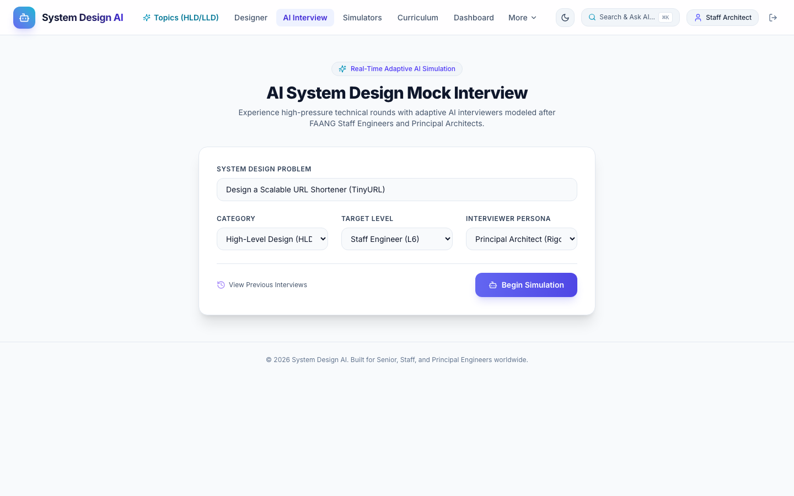

---

### 4. Interactive Simulators & Capacity Calculators (18 Tools)
Live distributed system simulators for capacity planning (QPS, Bandwidth, Storage), animated Consistent Hashing ring, Token Bucket rate limiting, and Circuit Breaker state machines.

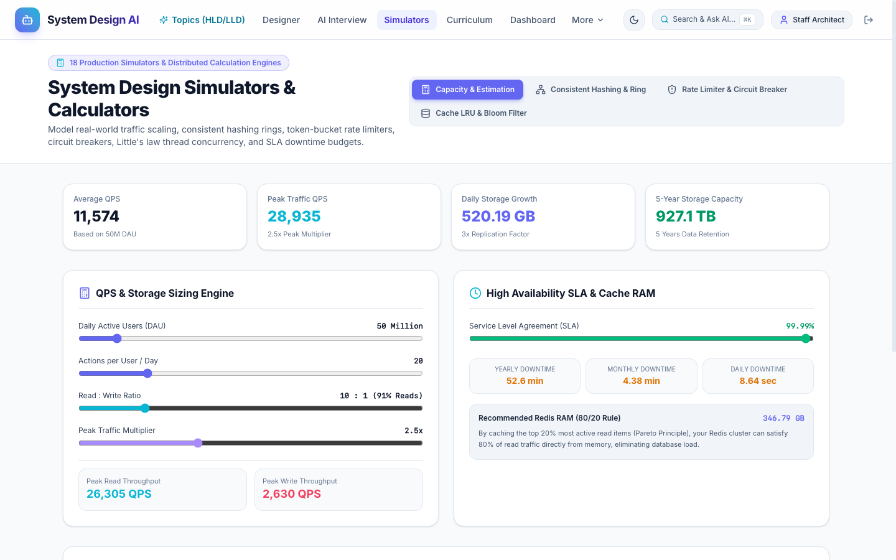

---

### 5. Candidate Analytics & Learning Dashboard
Track preparation streaks, interview readiness scores, radar competency charts, and personalized AI recommendations.

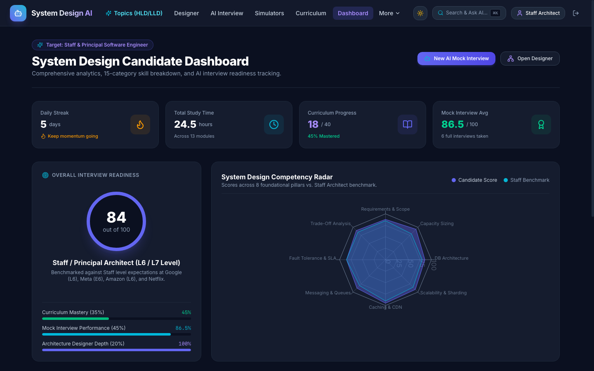

---

### 6. Curriculum Hub & Practice Modules
Structured 13-module system design curriculum, top-tier FAANG question bank, and dedicated HLD/LLD practice problem hubs.

| Curriculum (13 Modules) | Top-Tier Question Bank |
|:---:|:---:|
| 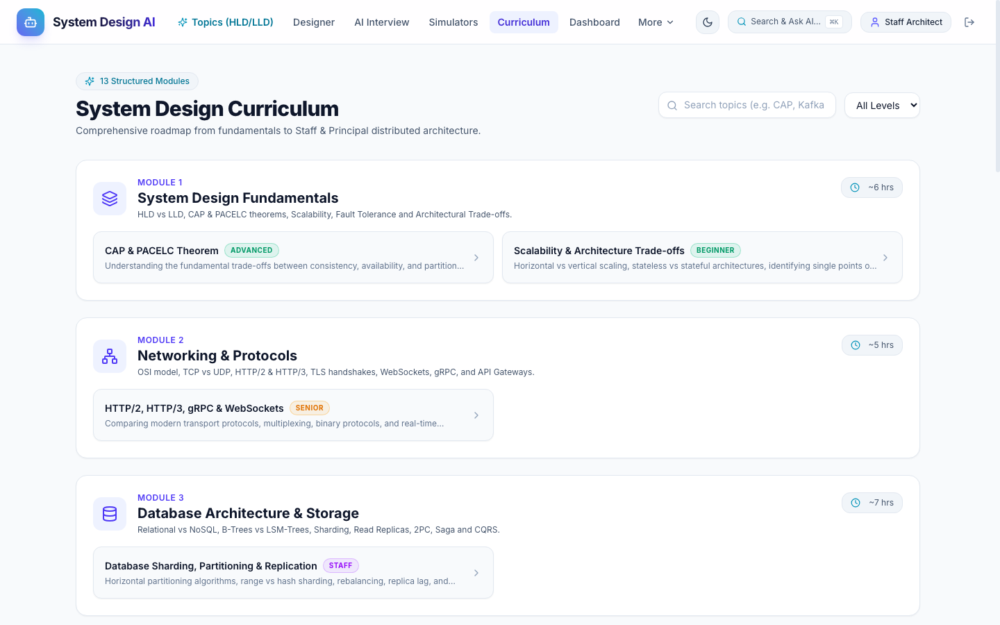 | 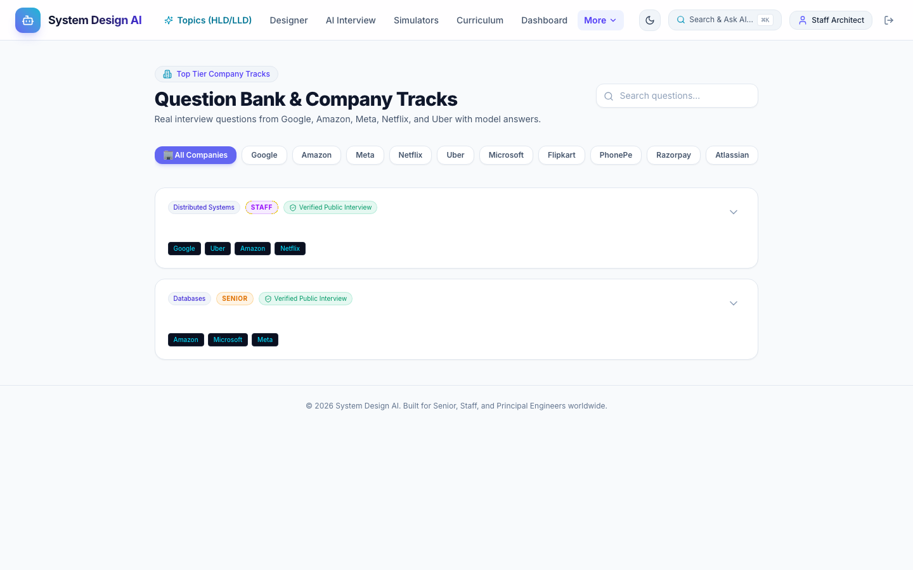 |

| HLD Practice Hub (40+ Blueprints) | LLD Practice Hub (20+ Blueprints) |
|:---:|:---:|
| 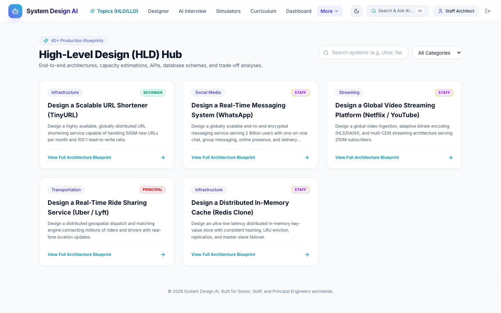 | 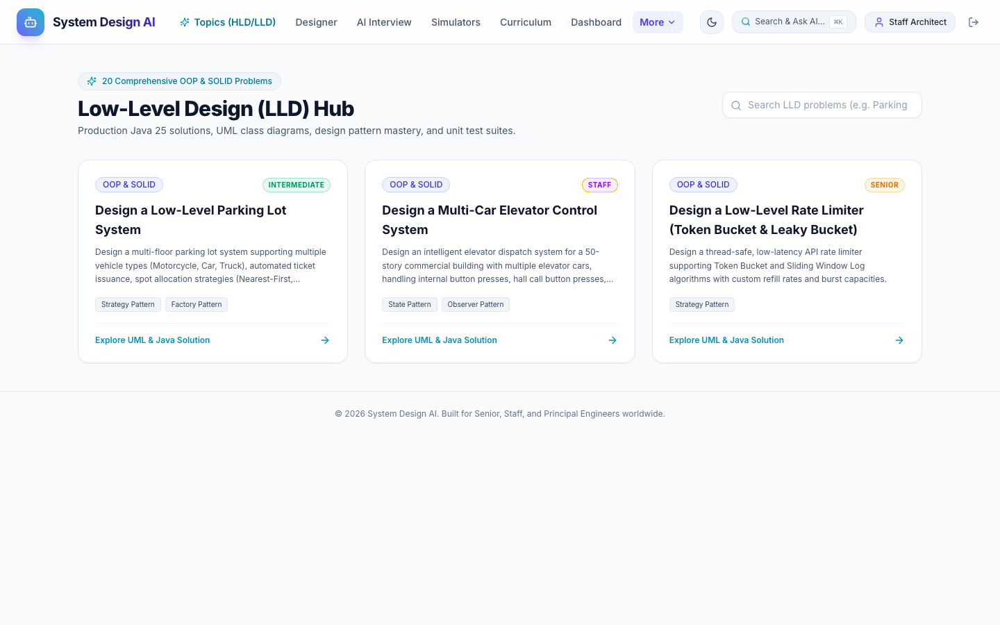 |

---

### 7. Administration & Monetization Control
Monitor JVM telemetry, AI token consumption quotas, and user tier subscriptions.

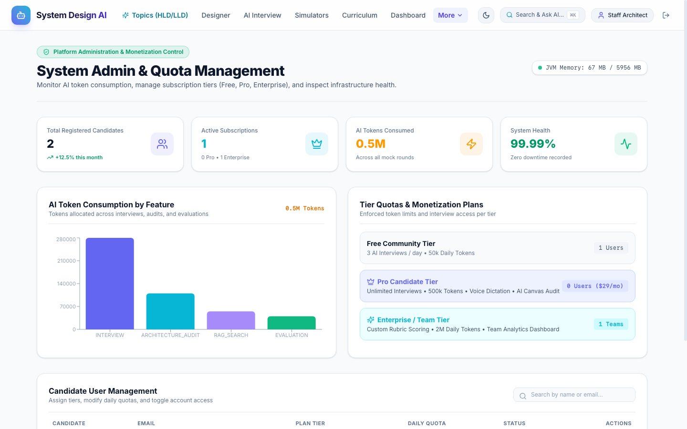

---

## 🛠️ Technology Stack

| Layer | Technologies |
|---|---|
| **Frontend** | React 19+, TypeScript, Vite, Tailwind CSS v4, Redux Toolkit, React Router, TanStack Query, React Flow (`@xyflow/react`), Monaco Editor, Mermaid.js, Recharts, Lucide React, Axios, SockJS + STOMP WebSocket |
| **Backend** | Java 25 LTS, Spring Boot 3.4+, Spring Security (Stateless JWT), Spring Data JPA, Hibernate, PostgreSQL 16+ (pgvector), Redis 7+, Apache Kafka, Spring WebSocket, Spring Validation, Actuator, Flyway, OpenAPI/Swagger |
| **AI Layer** | Google Gemini API (Gemini 2.5 Flash / Pro, text-embedding-004), Sliding-Window Context Memory, JSON Schema Structured Outputs, Semantic Vector RAG |
| **DevOps** | Docker, Docker Compose, Nginx, GitHub Actions, Jenkins, Prometheus, Grafana, SonarQube, k6 |

---

## 📂 Directory Structure

```
sysdesign-ai/
├── backend/                  # Spring Boot 3.4+ / Java 25 Application
│   ├── src/main/java/com/sysdesign/
│   ├── src/main/resources/
│   │   ├── application.yml
│   │   ├── data/topics-catalog.json  # 105 System Design topics
│   │   └── db/migration/             # Flyway PostgreSQL migrations
│   └── pom.xml
├── frontend/                 # React 19 + TypeScript + Vite Application
│   ├── src/
│   │   ├── components/       # Shared UI & Layout components
│   │   ├── pages/            # Feature pages
│   │   ├── services/         # API & WebSocket clients
│   │   ├── store/            # Redux Toolkit state slices
│   │   └── types/            # TypeScript interfaces
│   ├── index.html
│   └── package.json
├── docs/                     # Architecture, Database, API & Screenshots
│   ├── screenshots/          # Platform visual tour screenshots
│   ├── ARCHITECTURE.md
│   ├── DATABASE.md
│   ├── API.md
│   ├── AI_INTEGRATION.md
│   ├── DEPLOYMENT.md
│   ├── TESTING.md
│   └── DEVELOPMENT_PROGRESS.md
├── docker/                   # Docker Compose & container configurations
│   ├── docker-compose.yml
│   ├── Dockerfile.backend
│   ├── Dockerfile.frontend
│   └── nginx.conf
└── README.md
```

---

## ⚡ Quick Start

### Prerequisites
- Java 25 LTS
- Node.js 22+ & npm
- Docker & Docker Compose
- Google Gemini API Key

### 1. Clone & Configure
```bash
git clone https://github.com/VirendraArekar/sysdesign-ai.git
cd sysdesign-ai
cp .env.example .env
# Edit .env and supply your GEMINI_API_KEY
```

### 2. Run with Docker Compose
```bash
docker compose -f docker/docker-compose.yml up -d
```
Access the application at:
- Frontend UI: `http://localhost:3000`
- Backend API & Swagger: `http://localhost:8080/swagger-ui.html`
- Prometheus: `http://localhost:9090`
- Grafana: `http://localhost:3001`

---

## 📖 Documentation
- [System Architecture](docs/ARCHITECTURE.md)
- [Database Schema & ERD](docs/DATABASE.md)
- [REST API & WebSocket Documentation](docs/API.md)
- [Development Progress & Phase History](docs/DEVELOPMENT_PROGRESS.md)

---

## 📄 License
This project is licensed under the MIT License.
