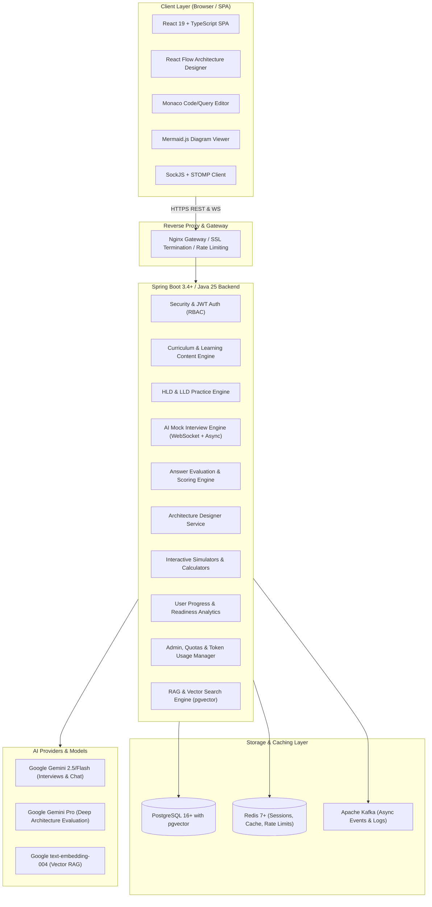

# System Design AI — Architecture Specification

## 1. Executive Summary

**System Design AI** is a production-grade, AI-powered System Design Interview Preparation and Simulation Platform. The platform provides software engineers (from beginner to staff/principal levels) with a full learning curriculum, interactive architecture modeling, dynamic AI-driven mock interviews, detailed grading across 15 technical dimensions, and interactive distributed systems simulators.

---

## 2. High-Level Architecture



---

## 3. Modular Monolith Backend Design

The backend is structured as a high-cohesion, low-coupling modular monolith within Spring Boot:

```
backend/src/main/java/com/sysdesign/
├── SysDesignAiApplication.java
├── config/
│   ├── SecurityConfig.java
│   ├── WebMvcConfig.java
│   ├── WebSocketConfig.java
│   ├── RedisConfig.java
│   ├── OpenApiConfig.java
│   └── GeminiConfig.java
├── common/
│   ├── ApiResponse.java
│   ├── BaseEntity.java
│   ├── exception/
│   │   ├── GlobalExceptionHandler.java
│   │   ├── ResourceNotFoundException.java
│   │   ├── UnauthorizedException.java
│   │   └── BadRequestException.java
│   └── security/
│       ├── JwtTokenProvider.java
│       ├── JwtAuthenticationFilter.java
│       └── UserPrincipal.java
├── modules/
│   ├── auth/
│   ├── user/
│   ├── curriculum/
│   ├── practice/
│   ├── interview/
│   ├── evaluation/
│   ├── architecture/
│   ├── simulator/
│   ├── analytics/
│   ├── admin/
│   └── ai/
```

---

## 4. AI Engine & RAG Architecture

1. **Provider Abstraction**: A decoupled `AiProvider` interface with `GeminiAiProviderImpl` supporting streaming, JSON schema structured responses, and fallback handling.
2. **Context Manager**: Sliding-window conversation memory with token tracking to fit within Gemini's context window.
3. **RAG Pipeline**:
   - Content chunking (500 tokens with 50-token overlap).
   - Embedding generation via `text-embedding-004`.
   - Vector storage in PostgreSQL using the `pgvector` extension (HNSW index for cosine distance).
   - Augmented prompt assembly with retrieved domain knowledge chunks.
4. **Structured Output**: AI prompts enforce deterministic JSON schemas validated by Jackson to ensure bulletproof scoring and diagram reviews.

---

## 5. Security & Multi-Tenancy

- **Authentication**: Stateless JWT access tokens (15-min TTL) + secure HTTP-only refresh tokens (7-day TTL).
- **Authorization**: Role-Based Access Control (RBAC) with `ROLE_USER`, `ROLE_PRO`, `ROLE_ADMIN`.
- **Rate Limiting**: Redis Token Bucket algorithm per user ID and IP address.
- **Input Sanitization**: OWASP HTML/SQL injection prevention and Zod schema validation on frontend and Hibernate/JPA parameter binding on backend.

---

## 6. Frontend Architecture

- **State Management**: Redux Toolkit for global session/auth state; TanStack Query v5 for server state caching and revalidation.
- **Styling**: Tailwind CSS v4 with custom dark palette:
  - Background: `#0B1020`
  - Surface: `#151C2E`
  - Primary: `#6366F1`
  - Secondary: `#06B6D4`
  - Accent: `#A78BFA`
  - Success: `#22C55E`
  - Text: `#F8FAFC`
- **Architecture Designer**: `@xyflow/react` (React Flow) with customized drag-and-drop system components (Load Balancers, Microservices, Caches, Kafka, DBs).
- **Simulators**: Interactive client-side and server-verified simulation engines for distributed systems principles (CAP theorem, Consistent Hashing, Rate Limiting, Kafka Partitions, Sharding).
