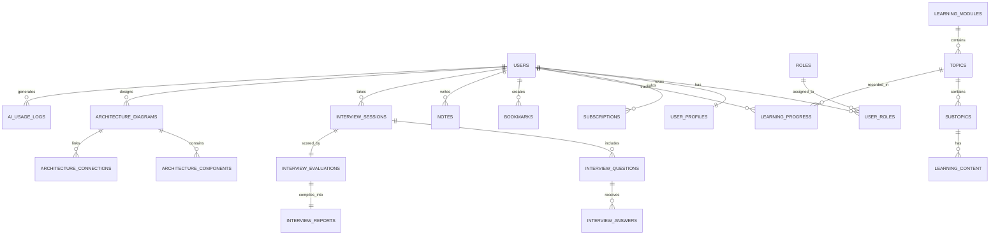

# System Design AI — Database Architecture & ERD Specification

## 1. Database Overview

- **Engine**: PostgreSQL 16+
- **Extensions**:
  - `uuid-ossp` (Unique UUID generation)
  - `vector` (pgvector for semantic search & RAG embeddings)
- **Design Principles**:
  - 3NF Normalized relational schema
  - Strong foreign key constraints with indexed join columns
  - Soft-delete flags and audit timestamps (`created_at`, `updated_at`)
  - JSONB used judiciously for unstructured configurations (e.g., node layout attributes, interview transcript metadata)

---

## 2. Entity-Relationship Diagram (ERD)

---

## 3. Comprehensive Table Specifications

### 3.1 Authentication & User Management
1. **`users`**
   - `id`: UUID PRIMARY KEY DEFAULT gen_random_uuid()
   - `email`: VARCHAR(255) UNIQUE NOT NULL
   - `password_hash`: VARCHAR(255) NOT NULL
   - `full_name`: VARCHAR(120) NOT NULL
   - `avatar_url`: VARCHAR(512)
   - `is_active`: BOOLEAN DEFAULT TRUE
   - `email_verified`: BOOLEAN DEFAULT FALSE
   - `created_at`: TIMESTAMPTZ DEFAULT CURRENT_TIMESTAMP
   - `updated_at`: TIMESTAMPTZ DEFAULT CURRENT_TIMESTAMP

2. **`roles`**
   - `id`: INT GENERATED ALWAYS AS IDENTITY PRIMARY KEY
   - `name`: VARCHAR(50) UNIQUE NOT NULL (`ROLE_USER`, `ROLE_PRO`, `ROLE_ADMIN`)
   - `description`: VARCHAR(255)

3. **`user_roles`**
   - `user_id`: UUID REFERENCES users(id) ON DELETE CASCADE
   - `role_id`: INT REFERENCES roles(id) ON DELETE CASCADE
   - PRIMARY KEY (user_id, role_id)

4. **`user_profiles`**
   - `id`: UUID PRIMARY KEY DEFAULT gen_random_uuid()
   - `user_id`: UUID UNIQUE REFERENCES users(id) ON DELETE CASCADE
   - `target_role`: VARCHAR(100) -- e.g., Senior SDE, Staff Architect
   - `experience_years`: INT DEFAULT 0
   - `target_companies`: TEXT[] -- e.g., ['Google', 'Amazon', 'Meta']
   - `preferred_level`: VARCHAR(50) DEFAULT 'INTERMEDIATE'
   - `interview_readiness_score`: NUMERIC(5,2) DEFAULT 0.00
   - `daily_streak`: INT DEFAULT 0
   - `last_active_date`: DATE

### 3.2 Curriculum & Learning Management
5. **`learning_modules`**
   - `id`: VARCHAR(64) PRIMARY KEY -- e.g., 'fundamentals', 'networking', 'database'
   - `title`: VARCHAR(255) NOT NULL
   - `description`: TEXT NOT NULL
   - `icon`: VARCHAR(100)
   - `sequence_order`: INT NOT NULL
   - `estimated_hours`: INT DEFAULT 5

6. **`topics`**
   - `id`: VARCHAR(100) PRIMARY KEY -- e.g., 'cap-theorem', 'consistent-hashing'
   - `module_id`: VARCHAR(64) REFERENCES learning_modules(id) ON DELETE CASCADE
   - `title`: VARCHAR(255) NOT NULL
   - `summary`: TEXT NOT NULL
   - `difficulty`: VARCHAR(20) DEFAULT 'INTERMEDIATE'
   - `sequence_order`: INT NOT NULL

7. **`subtopics`**
   - `id`: VARCHAR(120) PRIMARY KEY
   - `topic_id`: VARCHAR(100) REFERENCES topics(id) ON DELETE CASCADE
   - `title`: VARCHAR(255) NOT NULL
   - `sequence_order`: INT NOT NULL

8. **`learning_content`**
   - `id`: UUID PRIMARY KEY DEFAULT gen_random_uuid()
   - `topic_id`: VARCHAR(100) REFERENCES topics(id) ON DELETE CASCADE
   - `beginner_explanation`: TEXT NOT NULL
   - `deep_technical_explanation`: TEXT NOT NULL
   - `architecture_diagram_mermaid`: TEXT
   - `advantages`: JSONB DEFAULT '[]'::jsonb
   - `disadvantages`: JSONB DEFAULT '[]'::jsonb
   - `real_world_use_cases`: JSONB DEFAULT '[]'::jsonb
   - `interview_questions`: JSONB DEFAULT '[]'::jsonb
   - `practical_exercises`: JSONB DEFAULT '[]'::jsonb
   - `embedding`: vector(768) -- pgvector embedding for RAG

9. **`learning_progress`**
   - `id`: UUID PRIMARY KEY DEFAULT gen_random_uuid()
   - `user_id`: UUID REFERENCES users(id) ON DELETE CASCADE
   - `topic_id`: VARCHAR(100) REFERENCES topics(id) ON DELETE CASCADE
   - `status`: VARCHAR(20) DEFAULT 'NOT_STARTED' -- NOT_STARTED, IN_PROGRESS, COMPLETED
   - `time_spent_seconds`: INT DEFAULT 0
   - `completed_at`: TIMESTAMPTZ
   - UNIQUE (user_id, topic_id)

10. **`bookmarks`** & **`notes`**
    - Bookmarking topics, problems, and questions with user-scoped private notes.

### 3.3 HLD & LLD Practice
11. **`hld_problems`**
    - `id`: VARCHAR(100) PRIMARY KEY -- e.g., 'url-shortener', 'uber-system'
    - `title`: VARCHAR(255) NOT NULL
    - `category`: VARCHAR(100) NOT NULL
    - `difficulty`: VARCHAR(20) NOT NULL
    - `description`: TEXT NOT NULL
    - `functional_requirements`: JSONB NOT NULL
    - `non_functional_requirements`: JSONB NOT NULL
    - `capacity_estimation`: JSONB NOT NULL
    - `api_design`: JSONB NOT NULL
    - `database_schema`: JSONB NOT NULL
    - `architecture_diagram_mermaid`: TEXT NOT NULL
    - `deep_dive_topics`: JSONB NOT NULL
    - `trade_offs`: JSONB NOT NULL

12. **`lld_problems`**
    - `id`: VARCHAR(100) PRIMARY KEY -- e.g., 'parking-lot', 'elevator-system'
    - `title`: VARCHAR(255) NOT NULL
    - `difficulty`: VARCHAR(20) NOT NULL
    - `problem_statement`: TEXT NOT NULL
    - `solid_principles_applied`: JSONB NOT NULL
    - `design_patterns_used`: JSONB NOT NULL
    - `class_diagram_mermaid`: TEXT NOT NULL
    - `java_solution_code`: TEXT NOT NULL
    - `unit_tests_code`: TEXT NOT NULL
    - `extensibility_notes`: TEXT NOT NULL

13. **`question_bank`**
    - Question repository tagged by topic, company tracks (Google, Amazon, Meta, Netflix, Uber, etc.), and AI-generated vs verified public tags.

### 3.4 AI Interview Simulator & Evaluation
14. **`interview_sessions`**
    - `id`: UUID PRIMARY KEY DEFAULT gen_random_uuid()
    - `user_id`: UUID REFERENCES users(id) ON DELETE CASCADE
    - `category`: VARCHAR(50) NOT NULL -- HLD, LLD, DISTRIBUTED_SYSTEMS
    - `target_level`: VARCHAR(50) NOT NULL -- BEGINNER to PRINCIPAL
    - `interviewer_persona`: VARCHAR(50) DEFAULT 'STAFF_ENGINEER'
    - `problem_title`: VARCHAR(255) NOT NULL
    - `status`: VARCHAR(30) DEFAULT 'IN_PROGRESS' -- IN_PROGRESS, PAUSED, COMPLETED
    - `started_at`: TIMESTAMPTZ DEFAULT CURRENT_TIMESTAMP
    - `completed_at`: TIMESTAMPTZ
    - `duration_seconds`: INT DEFAULT 0

15. **`interview_questions`** & **`interview_answers`**
    - Chronological transcript of questions asked by the AI agent and answers provided by candidate with step numbers.

16. **`interview_evaluations`** & **`interview_reports`**
    - Evaluated across 15 criteria out of 100 with comprehensive feedback, strengths, weaknesses, and personalized study roadmaps.

### 3.5 Interactive Architecture Designer
17. **`architecture_diagrams`**
    - `id`: UUID PRIMARY KEY DEFAULT gen_random_uuid()
    - `user_id`: UUID REFERENCES users(id) ON DELETE CASCADE
    - `title`: VARCHAR(255) NOT NULL
    - `description`: TEXT
    - `canvas_data`: JSONB NOT NULL -- Full React Flow nodes and edges state
    - `ai_review`: JSONB -- Bottlenecks, SPOFs, security risks, recommendations
    - `created_at`: TIMESTAMPTZ DEFAULT CURRENT_TIMESTAMP
    - `updated_at`: TIMESTAMPTZ DEFAULT CURRENT_TIMESTAMP

### 3.6 Subscriptions, Quotas & Token Usage
18. **`subscriptions`**, **`usage_quotas`**, **`ai_usage_logs`**
    - Tracks Free vs Pro subscriptions, daily AI token budgets, model latency, and prompt tokens.
